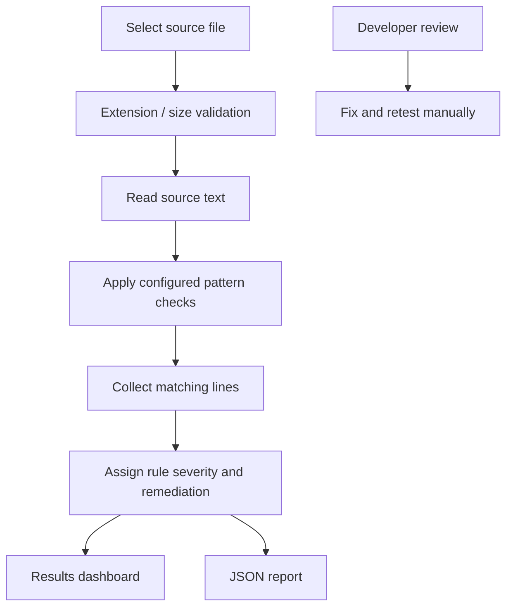

<div align="center">


[](https://www.python.org/)
[](https://flask.palletsprojects.com/)
[](#-responsible-use)
[](#-features)

**Find weaknesses. Strengthen code.**  
A lightweight rule-based source inspection tool with findings and remediation guidance.

[Features](#-features) · [Detection flow](#-how-it-works) · [Setup](#-getting-started) · [Test samples](#-quick-test) · [Limitations](#-scope--limitations)

</div>

---

## ◈ What is Vulnora?

Vulnora is a small Flask application that scans an uploaded source file against a set of implemented pattern-based checks. It reports matching lines, assigns a severity label, and provides remediation guidance to support a manual secure-code review.

> **Project context:** Developed for Task 3 — Secure Coding Review, as part of the CodeAlpha Cyber Security Internship.

## ✦ Features

| Capability | What it does |
|---|---|
| Source upload | Accepts supported source files defined by the app's allowlist. |
| Pattern-based checks | Looks for selected risky coding patterns using regular expressions and simple heuristics. |
| Findings | Reports a finding title, severity, line number, matched snippet, and suggested fix. |
| Triage summary | Counts high, medium, and low findings for the scan. |
| Sample files | Provides intentionally vulnerable Python and PHP examples for local testing. |
| JSON report | Saves the latest scan as `last_report.json` and provides a download route. |
| Local web UI | Flask dashboard at `127.0.0.1:5003`. |

## 🧪 How it works



1. A source file is uploaded through the dashboard.
2. The app validates the file type and reads its text.
3. The scanner checks lines against its configured regular-expression rules and a small number of heuristics.
4. Matching patterns become findings with severity labels and remediation suggestions.
5. The results page summarizes findings and allows a JSON report download.

## 🖥️ Getting started

### Requirements

- Python 3.10 or newer recommended.
- Flask (installed from `requirements.txt`).
- No database or external scanning service is required for the included local checks.

### Windows

```powershell
git clone https://github.com/<your-username>/Vulnora.git
cd Vulnora
py -m venv .venv
.\.venv\Scripts\Activate.ps1
python -m pip install --upgrade pip
pip install -r requirements.txt
python app.py
```

Or double-click `run_windows.bat`.

Open **http://127.0.0.1:5003**.

### Linux / macOS

```bash
python3 -m venv .venv
source .venv/bin/activate
pip install -r requirements.txt
python app.py
```

## 🔬 Quick test

1. Open the dashboard at `http://127.0.0.1:5003`.
2. Download the provided vulnerable Python sample and scan it.
3. Repeat with the vulnerable PHP sample.
4. Review each finding's title, severity, line, snippet, and remediation text.
5. Download the JSON report and open it in a text editor.
6. Modify a copy of a sample to remove a flagged pattern and scan again. A finding disappearing only shows that the matching pattern is no longer present; it does not prove the code is secure.

**Use the supplied vulnerable samples only as local training material. Do not deploy them.**

## 📁 Project structure

```text
Vulnora/
├── app.py                 # Flask routes, upload handling, pattern rules, report creation
├── requirements.txt       # Flask dependency
├── last_report.json       # Created after a scan
├── samples/
│   ├── vulnerable_app.py  # Intentionally vulnerable Python training sample
│   └── vulnerable_login.php # Intentionally vulnerable PHP training sample
├── templates/
│   ├── base.html
│   ├── index.html
│   └── results.html
├── run_windows.bat
└── run_linux_mac.sh
```

## 📄 Report contents

The JSON report includes the scanned filename, scan timestamp, source line count, finding records, and a severity-count summary. Each finding can include a title, severity, line number, short code snippet, and remediation guidance.

## ⚠️ Scope & limitations

- Vulnora is a **rule-based educational scanner**, not a comprehensive SAST product or a substitute for a professional security review.
- Pattern matching can produce false positives and false negatives. Code context, data flow, framework behavior, and runtime configuration may not be understood by these checks.
- A clean scan does not mean that the application is secure. Findings must be manually validated and tested.
- The tool analyzes uploaded source text; it does not execute the uploaded code. Keep it that way when testing untrusted samples.
- Do not upload confidential, proprietary, or production source code to a shared/public instance. This project is intended for local use.

## 🧑‍💻 Built for learning

Topics explored: secure coding, common vulnerability patterns, static source inspection, severity triage, remediation advice, and security reporting.

<div align="center">

**VULNORA** · Make secure code the default.

<sub>CodeAlpha Cyber Security Internship · Secure Coding Review</sub>

</div>
