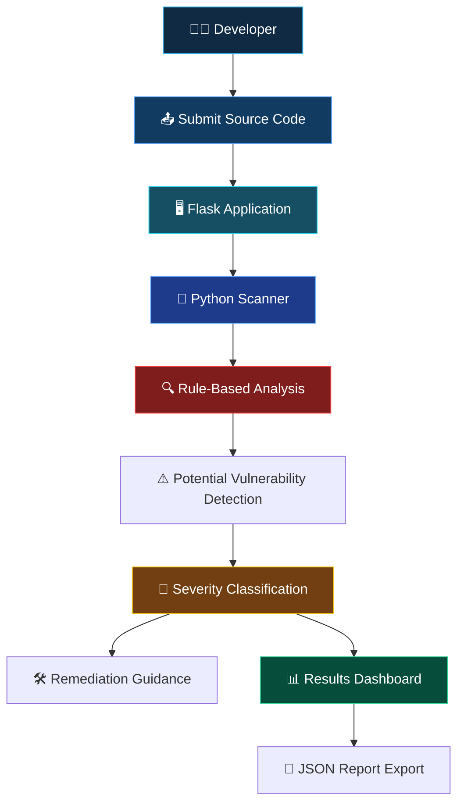

<div align="center">


<br>


**SCAN · DETECT · ANALYZE · REMEDIATE**

*A Python-based source-code security review tool designed to identify potentially vulnerable coding patterns and provide remediation guidance.*

<br>

[Overview](#-01--project-overview) · [Features](#-02--key-features) · [Architecture](#-03--system-architecture) · [Installation](#-04--installation) · [Testing](#-05--testing)

</div>

---

## ◈ 01 — Project Overview

**VULNORA** is a Python-based secure coding review application designed to inspect source code for potentially insecure coding patterns.

It uses predefined security checks to identify suspicious patterns associated with common application vulnerabilities and presents findings through a Flask dashboard.

The application is intended to help developers understand common coding weaknesses and learn how to improve application security.

> **Internship:** CodeAlpha Cyber Security Internship
> **Assigned Task:** Task 3 — Secure Coding Review.

### 🎯 Project Objective

To understand how insecure coding practices can introduce application vulnerabilities and how source-code inspection can help identify and remediate them.

**Important:** VULNORA uses rule-based pattern detection. It is not a complete static application security testing (SAST) engine, and its findings require manual validation.

---

## ✦ 02 — Key Features

<div align="center">

| Feature                     | Description                                                     |
| --------------------------- | --------------------------------------------------------------- |
| 🔍 Source Code Scanning     | Inspects submitted source code using predefined security rules. |
| 💉 SQL Injection Checks     | Identifies potentially unsafe SQL construction patterns.        |
| 🌐 XSS Checks               | Looks for potentially unsafe output-handling patterns.          |
| 🔐 Hardcoded Secret Checks  | Searches for suspicious hardcoded credentials or secrets.       |
| ⚙️ Command Injection Checks | Identifies potentially unsafe command-execution patterns.       |
| 🚦 Severity Classification  | Organizes findings according to assigned severity.              |
| 🛠️ Remediation Guidance    | Provides recommendations for addressing detected patterns.      |
| 📄 JSON Reports             | Exports scan findings in JSON format.                           |

</div>

---

## 🧬 03 — System Architecture



### Scanning Workflow

| Stage | Component      | Responsibility                              |
| ----- | -------------- | ------------------------------------------- |
| 01    | Source Code    | Receives the code submitted for review.     |
| 02    | Flask          | Handles the web application workflow.       |
| 03    | Python Scanner | Runs predefined security checks.            |
| 04    | Rule Engine    | Searches for potentially insecure patterns. |
| 05    | Classification | Assigns severity to findings.               |
| 06    | Remediation    | Provides suggested improvements.            |
| 07    | Report         | Displays and exports scan results.          |

---

## 🧰 04 — Technology Stack

| Technology | Purpose                           |
| ---------- | --------------------------------- |
| Python     | Scanner logic and security checks |
| Flask      | Web application backend           |
| HTML       | Dashboard structure               |
| CSS        | User interface styling            |
| JavaScript | Frontend interactions             |
| JSON       | Scan report export                |

---

## ⚡ 05 — Installation

### Requirements

* Python 3.10 or newer recommended.
* Git.
* Dependencies listed in `requirements.txt`.

### Windows

```powershell
git clone https://github.com/Prince-0j1/Vulnora.git
cd Vulnora

py -m venv .venv
.\.venv\Scripts\Activate.ps1

python -m pip install --upgrade pip
pip install -r requirements.txt

python app.py
```

### Linux / macOS

```bash
git clone https://github.com/Prince-0j1/Vulnora.git
cd Vulnora

python3 -m venv .venv
source .venv/bin/activate

python -m pip install --upgrade pip
pip install -r requirements.txt

python app.py
```

Open the local URL printed by the Flask application in your terminal.

---

## 🧪 06 — Testing

### Basic Scanner Test

1. Start VULNORA.
2. Open the local Flask dashboard.
3. Submit a small source-code sample.
4. Run the scan.
5. Review the reported findings.
6. Check severity classifications.
7. Review the remediation suggestions.
8. Export the JSON report.

### Example Test Patterns

The following snippets are intentionally insecure examples for testing a scanner in a controlled environment.

**Example 1 — Potential SQL Injection**

```python
query = "SELECT * FROM users WHERE name = '" + username + "'"
```

**Example 2 — Potential Command Injection**

```python
import os
os.system("ping " + user_input)
```

**Example 3 — Hardcoded Credential**

```python
password = "admin123"
```

**Expected result:** If the corresponding rules are implemented in the scanner, these patterns should produce relevant findings.

> Detection depends on the rules implemented by the current project version. These examples are not proof that every vulnerability will be detected.

---

## 📊 07 — Understanding Scan Results

| Finding Category     | What to Investigate                                               |
| -------------------- | ----------------------------------------------------------------- |
| SQL Injection        | Unsafe SQL query construction and missing parameterization.       |
| Cross-Site Scripting | Unescaped or unsafe handling of untrusted output.                 |
| Hardcoded Secrets    | Credentials, API keys, or sensitive values stored in source code. |
| Command Injection    | Unsafe use of external input in operating-system commands.        |

### Remediation Principles

* Use parameterized SQL queries.
* Apply context-appropriate output encoding.
* Store secrets in secure configuration or secret-management systems.
* Avoid passing untrusted input directly to shell commands.
* Validate and sanitize input according to the application's requirements.

---

## ⚠️ 08 — Scope & Limitations

VULNORA is an educational rule-based secure coding review tool.

* Pattern matching cannot understand every program's execution context.
* False positives and false negatives are possible.
* Complex data flows may not be detected.
* A reported pattern is not automatically an exploitable vulnerability.
* Absence of findings does not prove that source code is secure.
* Findings should be manually validated.
* It is not a replacement for professional SAST, DAST, code review, or penetration testing.

---

## 🎓 09 — Learning Outcomes

* Secure coding principles.
* Common application security weaknesses.
* SQL injection and XSS concepts.
* Hardcoded secret detection.
* Command injection risks.
* Source-code security inspection.
* Severity classification.
* Vulnerability remediation.
* Python and Flask application development.

---

## 👨‍💻 Developer

<div align="center">

### PRINCE KOTADIYA

**Cyber Security Student | Python Developer**

Built as part of the **CodeAlpha Cyber Security Internship**.

<br>

**VULNORA**

*Find weaknesses before attackers do.*

<sub>SCAN · DETECT · ANALYZE · REMEDIATE</sub>

</div>

---

<div align="center">


</div>
